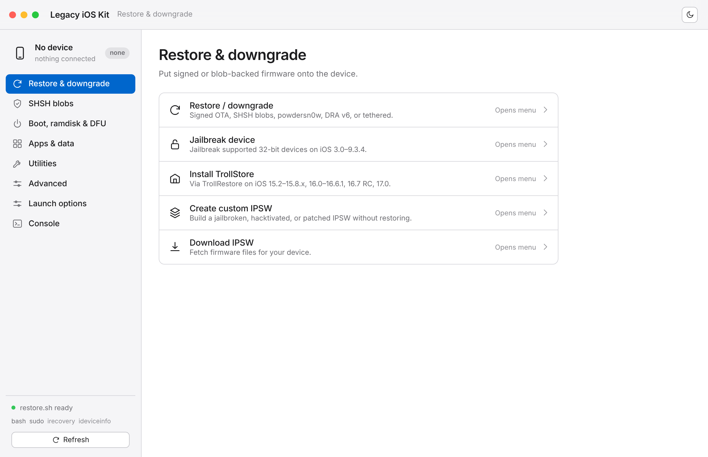
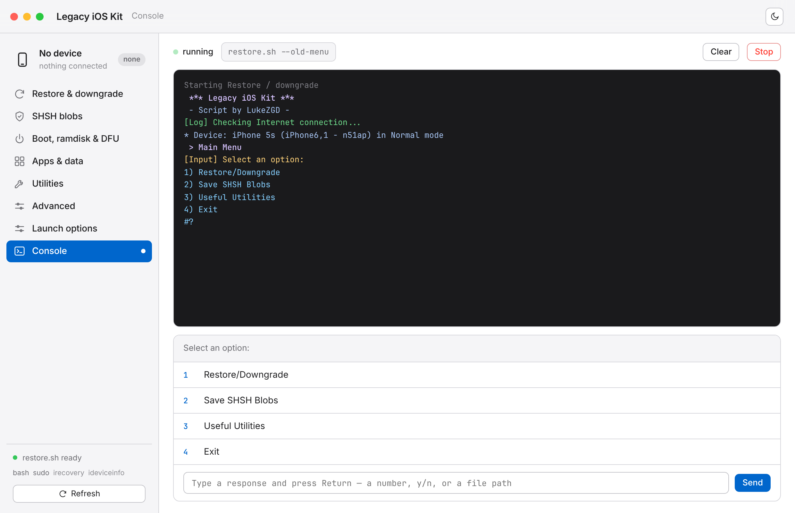

# iOS Kit — a desktop app for Legacy iOS Kit

A native-feeling desktop front-end for
[LukeZGD's Legacy iOS Kit](https://github.com/LukeZGD/Legacy-iOS-Kit) — the
all-in-one tool to restore/downgrade, save SHSH blobs, and jailbreak legacy iOS
devices.

Legacy iOS Kit is a terminal, menu-driven `bash` tool. This project wraps it in
a clean, Apple-style interface that runs the **real `restore.sh`** underneath:
it detects your connected device, lays out every feature as a grouped list like
macOS System Settings, and turns the tool's interactive prompts into buttons in
a live console.

| Home | Live console |
| --- | --- |
|  |  |

## Get it running

**From source (any platform with Python 3 + bash):**

```bash
./gui/launch.sh                 # locates restore.sh, opens the UI in your browser
```

**As a desktop app (native window):**

```bash
pip install -r desktop/requirements.txt
python3 desktop/app.py
```

**Prebuilt binaries** (portable + Windows installer) are produced by CI — see
[`desktop/README.md`](desktop/README.md). Push a `v*` tag or run the *Build
desktop app* workflow to generate them.

## What's here

- **`gui/`** — the interface: a zero-dependency Python server (`server.py`) and
  the web front-end (`static/`). See [`gui/README.md`](gui/README.md).
- **`desktop/`** — native-window wrapper and packaging (PyInstaller spec, Inno
  Setup installer, build scripts).
- **`.github/workflows/build.yml`** — builds Windows, macOS, and Linux binaries.
- **`DESIGN.md`** — the visual design system.

The front-end never performs a restore itself — it runs the official tool and
relays your input.

## Platform notes

Legacy iOS Kit officially supports **Linux and macOS**. On Windows the app runs
and the UI works, but driving a real device needs `bash` (Git for Windows or
WSL) and the tool's own dependencies — treat it as best-effort.

## Credits

Legacy iOS Kit is created and maintained by **LukeZGD**:
<https://github.com/LukeZGD/Legacy-iOS-Kit>. All restore/jailbreak logic is
theirs; read their [wiki](https://github.com/LukeZGD/Legacy-iOS-Kit/wiki) before
using it. This repository adds only the interface.
