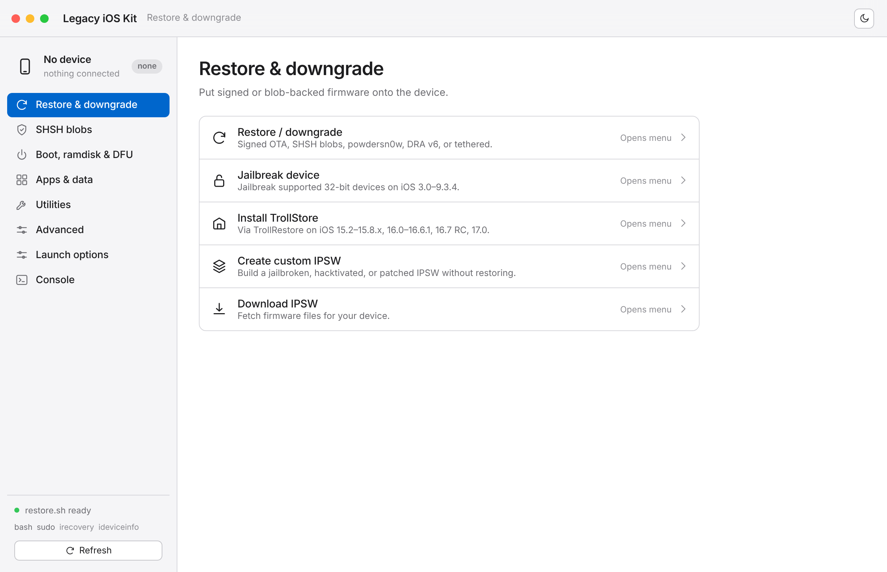

# Legacy iOS Kit — GUI

The interface layer: an Apple-style, System-Settings-like front-end for
[LukeZGD's Legacy iOS Kit](https://github.com/LukeZGD/Legacy-iOS-Kit) that runs
the **real `restore.sh`** and turns its menus into buttons.



## What it does

- **Detects your device** (Normal / Recovery / DFU) via `libimobiledevice`,
  `irecovery`, or USB enumeration, and shows model, iOS version, ECID, etc.
- **Runs the real tool.** Each action launches `restore.sh` — under a
  pseudo-terminal on Linux/macOS, or over pipes elsewhere — so interactive
  menus and `sudo` prompts behave as they do in a terminal.
- **Turns menus into buttons.** It drives the line-based `--old-menu` mode and
  parses numbered menus and y/N prompts into a grouped list, with a text box
  for any other response (paths, custom values).
- **Flags as toggles.** Common flags (`--enable-sudoloop`, `--jailbreak`,
  `--disable-bbupdate`, …) live under *Launch options* and apply to whatever you
  start next.

## Requirements

- **Python 3** (standard library only — no `pip install` needed for the server)
- **bash** and the Legacy iOS Kit itself (`restore.sh` + its `resources/`)
- Linux or macOS for real device work (Windows runs the UI; see repo README)

## Quick start

```bash
./gui/launch.sh                       # finds restore.sh, opens the browser
python3 gui/server.py --port 9000     # or run the server directly
```

For a native desktop window instead of a browser tab, see
[`../desktop/README.md`](../desktop/README.md).

### Pointing it at a specific restore.sh

Search order: `$LIK_RESTORE`, `gui/../restore.sh`,
`gui/Legacy-iOS-Kit/restore.sh`, the current directory, `~/Legacy-iOS-Kit/`, and
(when packaged) next to the executable.

```bash
LIK_RESTORE=/path/to/Legacy-iOS-Kit/restore.sh python3 gui/server.py
```

## Layout

```
gui/
├── launch.sh        # bootstrap: find restore.sh, start server, open browser
├── server.py        # zero-dependency backend: PTY/pipe runner + SSE + device probe
└── static/
    ├── index.html   # app shell (source list + grouped lists + console)
    ├── styles.css   # Apple HIG theming (light + dark)
    ├── menu.js      # faithful model of the tool's menus + flags
    └── app.js       # UI logic, incremental console rendering, prompt parsing
```

## Design & safety

- Visual system is documented in [`../DESIGN.md`](../DESIGN.md): monochrome
  glyphs, grouped inset lists, neutral palette, one action colour.
- The server binds to **127.0.0.1** only and never restores on its own.
- Restores often need USB permissions / `sudo` on Linux — enable **Sudo loop**
  in *Launch options*, or run the launcher from a terminal to answer prompts.

## Credits

Legacy iOS Kit is created and maintained by **LukeZGD**. This is only a
front-end for it.
